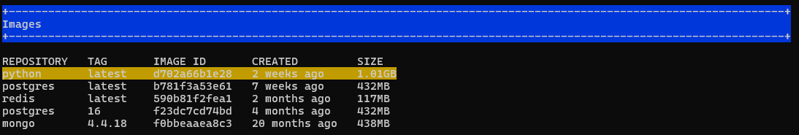
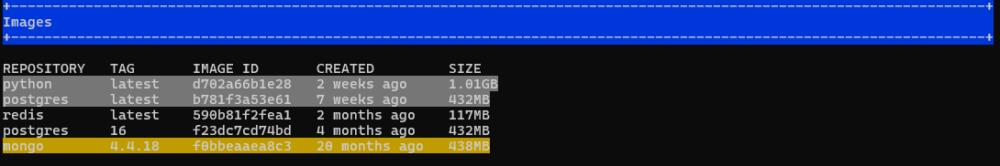
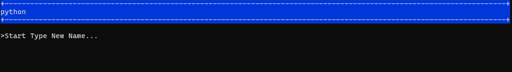
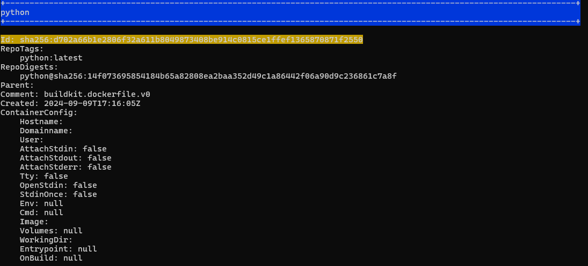
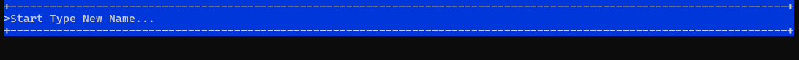
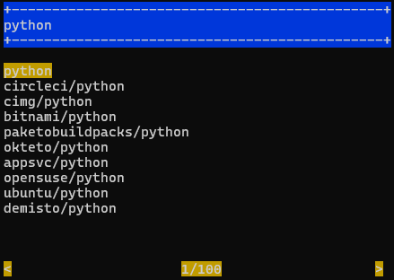
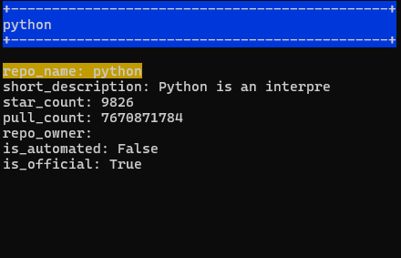
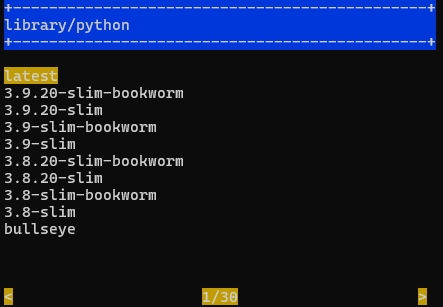
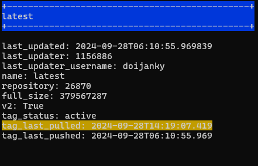

# docker_cmd
Консольное приложение для удобного 
взаимодействия с объектами Docker - образами, контейнерами и томами (`volumes`).
## Зависимости
Приложение использует модуль `curses` для отрисовки интерфейса в терминале и обработки нажатий клавиш. Проект опирается на стандартную библиотеку Python, чтобы упростить установку и запуск. В Linux дополнительные пакеты Python не нужны. В Windows требуется пакет `windows-curses`.
# Как запустить
Скачайте репозиторий:
```commandline
git clone https://github.com/AlbertSabirzianov/docker_cmd.git
```
Если вы используете Windows, нужно установить windows-curses. Для Linux зависимости не требуются:
```commandline
pip install windows-curses
```
Перейдите в папку src:
```commandline
cd docker_cmd/src
```
Запустите приложение:
```commandline
python3 main.py
```
# Как пользоваться
Сразу после запуска приложения вы увидите меню,
в котором отображаются все установленные на вашем устройстве образы Docker.
<br/><br/>
С помощью клавиш «вправо» и «влево» можно легко переключаться между вкладками с контейнерами и томами Docker (всего три вкладки: образы, тома и контейнеры).

Используйте клавиши «вперёд» и «назад»,
чтобы перемещать курсор.
Чтобы выбрать один или несколько объектов,
используйте клавишу «Пробел» или «Enter».
После этого выбранные объекты будут выглядеть так, как показано на изображении ниже.
<br/><br/>
Для взаимодействия с выбранными объектами можно использовать следующие клавиши:

- __d__ (*удалить*) удалить все выбранные объекты. Если объекты не выбраны, удаляется объект, на котором находится курсор.
- __r__  (*обновить*) обновить всю информацию об объектах Docker; все выбранные объекты будут сняты с выделения.
- __s__ (*сохранить*) сохранить все выбранные объекты в tar‑архив. Если объекты не выбраны, сохраняется объект, на котором находится курсор.
- **h** (*справка*) показать сообщение со справкой и всеми доступными командами.
- **q, ESC** (*выход*) выйти из окна справки (или из приложения).
- **n** (*переименовать*) переименовать объект, на котором находится курсор. После нажатия этой клавиши появится окно, как на изображении ниже:
 <br/> <br/>
 Вы увидите приглашение ввести новое имя для выбранного объекта. После того как вы введёте нужное имя и нажмёте «Enter», объект будет переименован. Чтобы выйти из режима ввода нового имени, нажмите **ESC** или **cntl + C**.</b>
- **i** (*подробная информация*) посмотреть детальную информацию об образе или контейнере, на котором находится курсор. Чтобы выйти, нажмите  **ESC** или **q**.
  <br/><br/>
  
- **p** (*поиск*) перейти в режим поиска образов на DockerHub. После перехода в этот режим появится приглашение ввести имя образа.
  <br/><br/>
   
  Когда вы начнёте вводить имя нужного образа, ниже начнут появляться доступные для загрузки образы на DockerHub. С помощью клавиш «вправо» и «влево» можно перейти к следующей/предыдущей странице. Текущую страницу и их общее количество можно увидеть внизу экрана. Чтобы выйти, нажмите **ESC** или **cntl + C**.
  <br/><br/>
  
  Если нажать клавишу **Пробел**  можно увидеть подробную информацию об образе, на котором находится курсор. Чтобы выйти, нажмите **ESC** или **q**
  <br/><br/>
  Чтобы выбрать найденный образ, нажмите **Enter**, после этого вы перейдёте в режим поиска нужного тега. Чтобы выйти, нажмите **ESC** или **cntl + C**
  <br/><br/>

Если нажать клавишу **Пробел** можно увидеть подробную информацию о теге, на котором находится курсор. Чтобы выйти, нажмите **ESC** или **q**.
<br/><br/>
Если вы хотите просто загрузить образ с тегом latest, можно нажать **l** образ с этим тегом будет загружен на ваше устройство. Чтобы выбрать найденный тег, нажмите **Enter**, 
после этого будет загружен образ с выбранным тегом. Чтобы выйти, нажмите **ESC** или **q**.
# Как установить команду `dv` (docker viewer)
Чтобы запускать приложение из любой директории короткой командой `dv`, 
используйте установочные скрипты из папки `src`. __После установки обязательно закройте и откройте консоль заново__
## Windows
1) установите зависимость
    ```commandline
    pip install windows-curses
    ```
2) Запустите установочный скрипт от имени администратора:
    ```commandline
    .\install.bat
    ```
3) Перезапустите консоль. Теперь доступна команда:
    ```commandline
    dv
    ```
## Linux

1) Сделайте установочный файл исполняемым
    ```commandline
    chmod +x install.sh
    ```
2) Запустите установку:
    ```commandline
    ./install.sh
    ```
3) Перезапустите терминал. Теперь доступна команда:
    ```commandline
    dv
    ```


---

# docker_cmd (English)

[Русская версия выше](#docker_cmd)

A console application for working with Docker objects: images, containers and volumes.

## Dependencies

The application uses the `curses` module to draw the interface in the terminal and to handle key presses. The project relies on the Python standard library to keep installation and startup simple. On Linux no extra Python packages are needed. On Windows the `windows-curses` package is required.

## How to run

Clone the repository:
```commandline
git clone https://github.com/AlbertSabirzianov/docker_cmd.git
```
If you use Windows, install windows-curses. On Linux no dependencies are required:
```commandline
pip install windows-curses
```
Go to the `src` folder:
```commandline
cd docker_cmd/src
```
Start the application:
```commandline
python3 main.py
```

## How to use

Right after the application starts you will see a menu that lists all Docker images installed on your machine.
<br/><br/>
Use the "right" and "left" arrow keys to switch between the tabs for containers and volumes (there are three tabs in total: images, volumes and containers).

Use the "up" and "down" arrow keys to move the cursor.
To select one or more objects, press "Space" or "Enter".
Selected objects look like this:
<br/><br/>
To work with the selected objects, use the following keys:

- __d__ (*delete*) delete all selected objects. If nothing is selected, the object under the cursor is deleted.
- __r__ (*refresh*) refresh all information about Docker objects; any selection is cleared.
- __s__ (*save*) save all selected objects to a tar archive. If nothing is selected, the object under the cursor is saved.
- **h** (*help*) show the help message with all available commands.
- **q, ESC** (*quit*) close the help window (or exit the application).
- **n** (*rename*) rename the object under the cursor. A window like the one below appears:
 <br/> <br/>
 You are prompted to enter a new name for the selected object. Type the name and press "Enter" to rename the object. To leave the rename prompt, press **ESC** or **Ctrl + C**.
- **i** (*detailed information*) show detailed information about the image or container under the cursor. To close it, press **ESC** or **q**.
  <br/><br/>

- **p** (*search*) switch to searching for images on Docker Hub. You are prompted to enter an image name.
  <br/><br/>

  As you type the name of the image you want, the images available for download on Docker Hub appear below. Use the "right" and "left" arrow keys to go to the next or previous page. The current page and the total number of pages are shown at the bottom of the screen. To leave search, press **ESC** or **Ctrl + C**.
  <br/><br/>

  Press **Space** to see detailed information about the image under the cursor. To close it, press **ESC** or **q**.
  <br/><br/>
  To choose the image you found, press **Enter**; you then move to searching for the tag you need. To leave, press **ESC** or **Ctrl + C**.
  <br/><br/>

Press **Space** to see detailed information about the tag under the cursor. To close it, press **ESC** or **q**.
<br/><br/>
If you just want to download the image with the `latest` tag, press **l** and the image with that tag is downloaded to your machine. To choose the tag you found, press **Enter**; the image with the selected tag is then downloaded. To leave, press **ESC** or **q**.

## How to install the `dv` (docker viewer) command

To start the application from any directory with the short command `dv`, use the installation scripts in the `src` folder. __After installing, be sure to close and reopen the console.__

### Windows
1) Install the dependency:
    ```commandline
    pip install windows-curses
    ```
2) Run the installation script as administrator:
    ```commandline
    .\install.bat
    ```
3) Restart the console. The following command is now available:
    ```commandline
    dv
    ```

### Linux

1) Make the installation file executable:
    ```commandline
    chmod +x install.sh
    ```
2) Run the installation:
    ```commandline
    ./install.sh
    ```
3) Restart the terminal. The following command is now available:
    ```commandline
    dv
    ```
